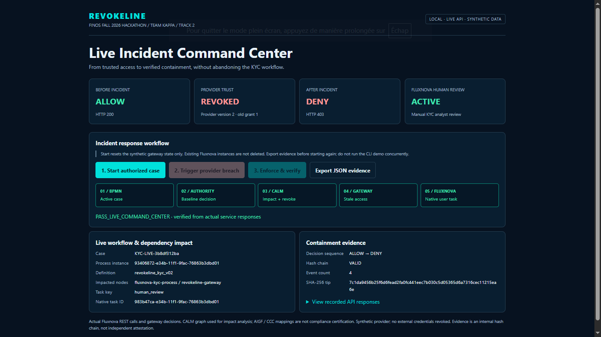
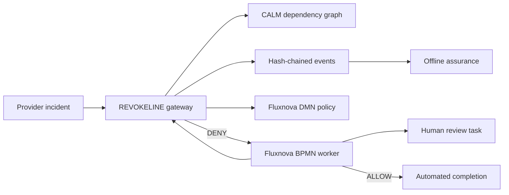
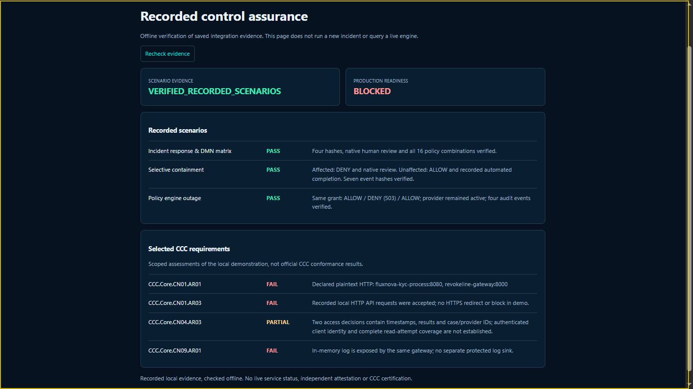

# REVOKELINE

Runtime incident response for FINOS Governance-as-Code.

**Hackathon Track:** Track 2 — Extend & Utilize FINOS Governance-as-Code
FINOS Fall 2026 Hackathon · Team Kappa

A KYC workflow can start with a trusted third-party provider and still be running when that provider is compromised. REVOKELINE checks authorization again at the next sensitive operation, refuses stale grants, and routes affected work to a native Fluxnova human review task. The prototype uses two synthetic providers and synthetic data. Revocation is scoped to the affected provider; an unaffected case can complete normally. If the policy engine is unavailable, the gateway refuses the sensitive call and allows the unchanged grant again once the policy becomes available.



## How it works



The gateway tracks provider status and grant versions. In DMN mode, a request must satisfy both the local safety guard and a decision from a pinned Fluxnova definition. A policy service failure does not grant access. The worker completes its BPMN task with the authorization outcome; a denied request leads to manual review.

| FINOS project | Integration |
| --- | --- |
| [CALM](https://calm.finos.org/) | Strict architecture validation and dependency traversal |
| [Fluxnova](https://github.com/finos/fluxnova-bpm-platform) | Executable BPMN workflow and DMN authorization policy |
| [AIGF](https://github.com/finos/ai-governance-framework) | Traceability to selected mitigation references |
| [CCC](https://ccc.finos.org/) | Scoped gap assessment against selected control requirements; not an official conformance test |

## Installation

Requirements: Python 3.12, Docker, and Node.js 22.13+ for the CALM CLI. See [local setup and demo](docs/RUNBOOK.md) for the complete sequence, including the DMN deployment and environment variables.

```sh
python -m pip install -r requirements.txt
npm install -g @finos/calm-cli
calm validate -a architectures/revokeline.calm.json --strict
```

## Usage example

Once the engine and gateway are running, use `python -m scripts.fluxnova_targeted_demo`, or start the Command Center on port 8001 as described in the runbook.

To reproduce the two-provider scenario with DMN enabled and Fluxnova history recording active:

```sh
python -m scripts.selective_containment --output evidence/selective-containment.json
```

See [selective containment](docs/SELECTIVE_CONTAINMENT.md) for setup and scope.

For the dedicated local engine stop/start exercise, see [policy outage and recorded assurance](docs/POLICY_OUTAGE.md). The read-only assurance view is available at `/assurance` on the Command Center; it recalculates checks on saved evidence and distinguishes missing or invalid evidence from verified scenarios.

## Results

Local integration runs on 18 November 2026 with Fluxnova 2.0.0:

- A previously authorized grant returned HTTP 200 before revocation and HTTP 403 afterwards. Fluxnova created an active `human_review` task.
- The live DMN policy returned the expected result for all 16 Boolean input combinations (1 ALLOW, 15 DENY).
- Selective containment: one affected request denied and routed to a native review task; one unaffected request allowed and its BPMN process completed normally (verified in Fluxnova history). The script checked seven chained audit events and four decisions against the pinned DMN definition.
- A real stop/start of the dedicated Fluxnova container produced HTTP 200 ALLOW, HTTP 503 DENY, then HTTP 200 ALLOW for the same grant. Four audit events were checked; the provider remained active.
- 68 regression tests passed (one Starlette deprecation warning); `pip check` found no broken requirements and CALM strict validation returned no errors or warnings.
- The recorded assurance view verified all three saved scenarios and retained `BLOCKED` for production readiness.
- Offline assurance accepted the original evidence, rejected an altered event and refused production approval.



The [recorded results](docs/RESULTS.md) explain the evidence and its scope. To inspect the saved run without a live engine:

```sh
python -m scripts.compare_policy --evidence-file evidence/gate5-live-dmn.json --require-dmn 618d4f37-e347-11f1-9fac-76863b3dbd01
```

The comparator models a cached ALLOW against the observed gateway DENY for one matched replay. It does not run an unprotected vendor call.

## Limitations

This is a local proof of concept, not a production security system. HTTP is not encrypted; gateway state and the audit chain are in memory. No external credentials are revoked. The audit export is not signed or independently anchored. The logical CALM graph does not separately model the optional DMN REST call. CCC assessments are scoped to the known local design; production approval remains blocked.

## Development setup

Use Python 3.12 and a virtual environment. Install dependencies with `python -m pip install -r requirements.txt` and run `python -m pytest tests -q`. The test suite includes local regression checks, mocked engine contracts and checks against a recorded integration export. Live Fluxnova checks are separate; see the [runbook](docs/RUNBOOK.md).

Development used AI-assisted design, coding and documentation. The live integration tests were run locally against Fluxnova 2.0.0.

## Roadmap

- Extend selective containment tests to larger, concurrent workloads and additional failure cases.
- Test independent policy-service failures and recovery under concurrent workloads.
- Add authenticated callers, encrypted transport and a separately protected audit sink before considering production use.

## Contributing

Follow [AGENTS.md](AGENTS.md) and [CONTRIBUTING.md](CONTRIBUTING.md). Submit changes through pull requests. Every contribution commit requires a Developer Certificate of Origin (DCO) sign-off matching its author; use `git commit -s`.

## License

Copyright 2026 FINOS

Distributed under the [Apache License, Version 2.0](http://www.apache.org/licenses/LICENSE-2.0).

SPDX-License-Identifier: [Apache-2.0](https://spdx.org/licenses/Apache-2.0)
